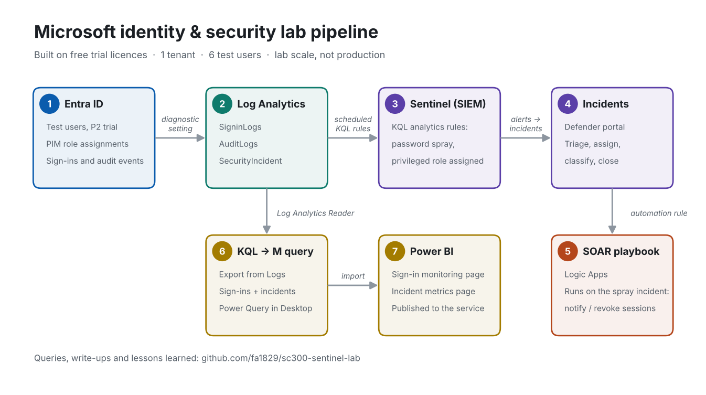

# Microsoft identity and security lab journal

A working record of how I am learning Microsoft identity and security operations hands-on: Entra ID, Microsoft Sentinel as a SIEM, KQL, the Defender portal and Power BI, alongside studying for SC-300 (Identity and Access Administrator).

**This is lab work, not production experience.** Everything runs in a personal Entra ID tenant with six test users, on free trials. The tools are the same ones organisations run; the scale, the data and the stakes are not. Why I built it, and what it can and cannot show, is in [docs/00-why-this-lab.md](docs/00-why-this-lab.md).

## What is in this repo

| Path | Contents |
|---|---|
| [docs/00-why-this-lab.md](docs/00-why-this-lab.md) | The interview question that started this, and what a lab can and cannot prove |
| [docs/01-environment-setup.md](docs/01-environment-setup.md) | How the lab was built, step by step, including the wrong turns |
| [docs/02-detections.md](docs/02-detections.md) | Detection rules, how each was tested, and their known weaknesses |
| [docs/03-incident-triage.md](docs/03-incident-triage.md) | Incidents the rules produced and how I handle them |
| [docs/04-lessons-learned.md](docs/04-lessons-learned.md) | Things that did not work the way I expected |
| [docs/05-powerbi-pipeline.md](docs/05-powerbi-pipeline.md) | Sentinel / Log Analytics to Power BI: how it works and what broke |
| [docs/06-learning-roadmap.md](docs/06-learning-roadmap.md) | Which Microsoft products and certifications I am working through, and what free trials allow |
| [docs/07-kql-notes.md](docs/07-kql-notes.md) | KQL patterns I learned from my own queries |
| [docs/sc300-study-log.md](docs/sc300-study-log.md) | SC-300 study tracker and dated log |
| [detections/](detections/) | KQL for each rule, one file per rule |
| [powerbi/](powerbi/) | DAX measures and report layout: sign-in page and incidents page |
| [diagrams/](diagrams/) | Pipeline diagram (PNG) |
| [sample-data/](sample-data/) | Sanitised query output used to validate the rules |
| [screenshots/](screenshots/) | Evidence screenshots (redacted before commit) |

## Current status

Last updated: 2026-11-20

| Item | Status |
|---|---|
| Azure free trial subscription in lab tenant | Done |
| Log Analytics workspace with 1 GB daily cap | Done |
| Microsoft Sentinel enabled (31-day trial) | Done |
| Entra ID sign-in and audit logs connected | Done |
| Rule: password spray | Deployed, fired on test data |
| Rule: privileged role assigned (PIM-aware) | Deployed, fired on test data |
| Rule: impossible travel | Query written. Successful sign-ins now exist, but all from one country, so **not yet tested** |
| Incident triage and closure notes | To do |
| Power BI: KQL to M query connection | Done |
| Power BI: sign-in dashboard | Built; layout polish in progress |
| Power BI: incidents page (SecurityIncident) | To do |
| Power BI: published to the Power BI service, scheduled refresh working | Done |
| Logic Apps playbook (SOAR) | To do |
| Exported rule JSON | To do |
| SC-300 exam | Studying |

## Lab architecture



```
Entra ID lab tenant (P2 trial licence)
  |  diagnostic setting: SignInLogs, NonInteractiveUserSignInLogs, AuditLogs
  v
Log Analytics workspace  law-sentinel-lab  (Canada Central, 1 GB/day cap)
  |                                   |
  v                                   v
Microsoft Sentinel                    Power BI Desktop
  scheduled KQL rules                   KQL exported as an M query
  -> incidents in the Defender portal   -> sign-in monitoring dashboard
```

## Detections at a glance

| Rule | Table | Logic | MITRE ATT&CK | Severity |
|---|---|---|---|---|
| Password spray: one IP, many accounts | `SigninLogs` | One IP with bad-password failures against 5 or more accounts in 30 minutes | T1110 (Brute Force) | Medium |
| Privileged role assigned | `AuditLogs` | A user is added to a high-privilege Entra role, including through PIM | T1098 (Account Manipulation) | High |
| Impossible travel (simplified) | `SigninLogs` | Successful sign-ins from more than one country within an hour | T1078 (Valid Accounts) | Medium |

## Limits of this lab

- Six test users and one source IP. Thresholds are tuned to that, not to a real organisation's traffic.
- The rules have only been tested against activity I generated myself. I have no false-positive data from real users.
- The Azure credit and the Sentinel trial both end in December 2026, so the environment is temporary. The queries, notes and sanitised data in this repo are what persists.
- Tenant name, IP addresses, workspace and subscription identifiers are replaced or removed throughout.

## Author

Faisal. MASc in Information Systems Security (Concordia University, 2026); about 16 years in telecommunications before that.
